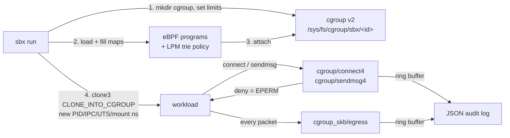

# Ephemeral Sandbox & eBPF Firewall

[](https://github.com/mohsinkhanshaik/ephemeral-sandbox-ebpf-firewall/actions/workflows/ci.yml)   

`sbx` runs untrusted or AI-generated code in a **short-lived sandbox** whose network egress is enforced **in the kernel with eBPF**. Each sandbox gets its own cgroup v2, its own copy of the firewall programs and maps, a throwaway tmpfs workspace, resource limits and a hard TTL. When the sandbox ends, everything it created is gone.

```bash
sudo sbx run --allow api.openai.com:443 --allow-dns --ttl 5m --memory 1G -- python3 agent.py
```

## Why

Agents, CI jobs and code interpreters increasingly execute code nobody reviewed. The two things that go wrong most often are **data exfiltration** and **resource abuse**. iptables rules are host-wide and hard to scope per job. Full VMs are slow to start. `sbx` sits in between: per-workload, default-deny egress, applied from the process's very first syscall, set up in milliseconds.

## How it works



**Two enforcement layers**

| Layer | Hook | What it gives you |
|---|---|---|
| Socket | `cgroup/connect4`, `cgroup/sendmsg4` | Denied connections fail immediately with `EPERM`, so the workload gets a clear error instead of a hanging SYN. |
| Packet | `cgroup_skb/egress` | A default-deny backstop for anything that bypasses socket hooks: raw sockets, ICMP, odd protocols. Parses IPv4 and L4 headers itself. |
| IPv6 | `cgroup/connect6`, `cgroup/sendmsg6` | Denied, except `::1` when loopback is allowed. |

**Policy lookup.** Allowed destinations live in a `BPF_MAP_TYPE_LPM_TRIE` keyed by `{port, IPv4 prefix}`. Putting the port *before* the address lets one longest-prefix lookup match "this CIDR on this port". Port `0` means any port, so a check is at most two O(prefix-length) lookups, independent of the number of rules.

**No race at startup.** The workload is spawned straight into its cgroup with `clone3(CLONE_INTO_CGROUP)` *after* the programs are attached, so there is no window where it runs unfiltered.

**Guaranteed teardown.** TTL expiry, Ctrl-C, or the workload forking into the background all end the same way: `cgroup.kill` (or SIGKILL per PID on kernels < 5.14), wait until `cgroup.procs` is empty, `rmdir` the cgroup, detach the eBPF links, unmount and delete the workspace.

## Features

- Default-deny IPv4 egress with CIDR, host, port and hostname rules (`--allow`)
- `--allow-dns` reads `/etc/resolv.conf` and opens only port 53 to those resolvers
- Per-sandbox limits: `--memory`, `--cpus`, `--pids`, `--workspace-size`
- Runs as `nobody` by default (`--user`)
- Hard `--ttl` (exit code `124`, like `timeout(1)`)
- JSON audit log of every denied connection or packet, plus a summary at exit:

```json
{"level":"INFO","msg":"egress","sandbox":"9f2c1a7e","verdict":"deny","hook":"connect4","proto":"tcp","dst":"8.8.8.8:443"}
{"sandbox":"9f2c1a7e","exit_code":7,"reason":"exited","duration":"5.012s","conn_allowed":0,"conn_denied":1,"pkts_dropped":0,"cpu_usec":31211,"mem_peak_bytes":4562944}
```

## Quick start

Requirements: Linux 5.15+ with cgroup v2 and BTF, root, Go 1.22+, clang, libbpf headers.

```bash
sudo apt-get install -y clang llvm libbpf-dev
make deps generate build
sudo ./bin/sbx check

# allowed
sudo ./bin/sbx run --allow 1.1.1.1:443 -- curl -sI https://1.1.1.1
# denied: curl: (7) Failed to connect ... Operation not permitted
sudo ./bin/sbx run --allow 1.1.1.1:443 -- curl -sI https://8.8.8.8
```

### Policy syntax

| `--allow` value | Meaning |
|---|---|
| `1.1.1.1` | one host, any port |
| `1.1.1.1:443` | one host, one port |
| `10.0.0.0/8:5432` | a prefix, one port |
| `api.example.com:443` | hostname, resolved once at start |

## Project layout

```
bpf/firewall.bpf.c          eBPF programs (socket + packet hooks, LPM trie, ring buffer)
internal/policy             rule parsing and kernel key encoding (portable, unit tested)
internal/firewall           load / attach / events / stats via cilium/ebpf
internal/sandbox            cgroup v2, namespaces, tmpfs workspace, teardown
cmd/sbx                     CLI
scripts/e2e.sh              tests against the real kernel (run in CI)
```

## Testing

- `make test`: unit tests for rule parsing and byte-order encoding.
- `make e2e`: real-kernel checks in CI. Allowed host reachable, other hosts blocked, port enforced, UDP enforced, TTL kill, background processes reaped with no leftover cgroups, memory limit triggers OOM.

## Limitations

This is a lightweight sandbox, not a VM or a full container runtime. Be clear about what it does not do:

- The filesystem is the host's (with a private tmpfs workspace and a non-root user). Pair it with read-only bind mounts or a rootfs if you need filesystem isolation.
- Network policy is IPv4 only; IPv6 is blocked rather than filtered.
- Hostname rules are resolved once at start. CDNs that rotate IPs may need a CIDR rule.
- No seccomp profile yet. A root user inside the sandbox could detach the programs, which is why the default user is `nobody`.

## Roadmap

- [ ] seccomp-bpf profile and dropped capabilities
- [ ] Optional overlay rootfs with pivot_root
- [ ] DNS-aware policy: allow by name, learn IPs from DNS answers
- [ ] IPv6 CIDR rules
- [ ] Prometheus metrics for long-running sandbox pools

## License

MIT. The eBPF program is dual-licensed MIT/GPL-2.0 as the kernel requires.
